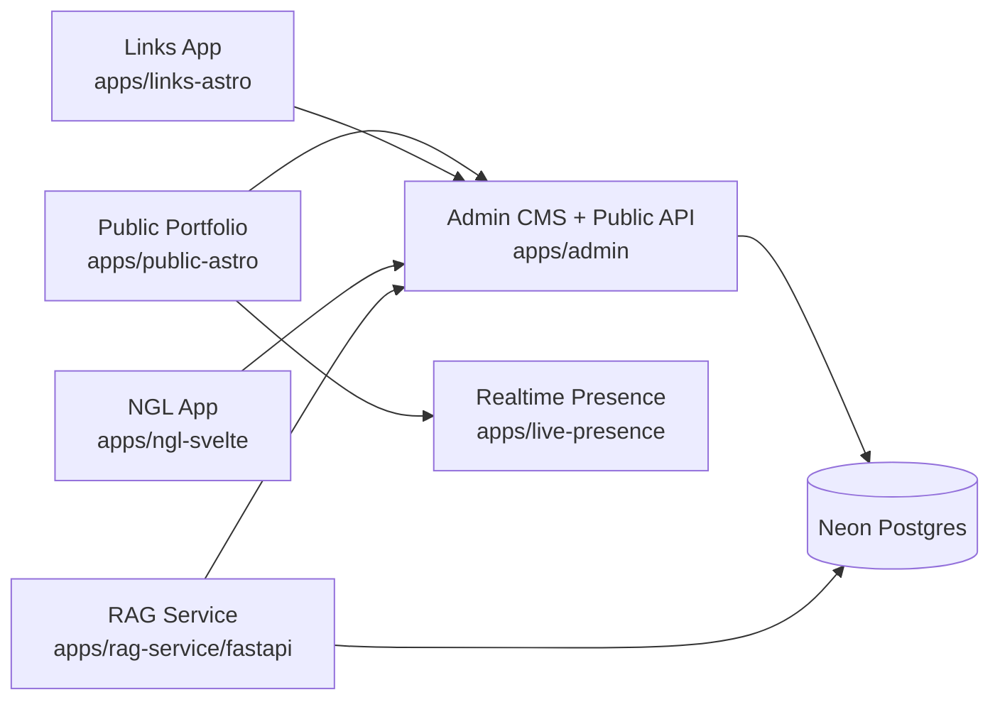

# NaufalRF Portfolio Platform

> Production-oriented multi-app portfolio platform powered by Bun, FastAPI, and a centralized Neon/Postgres architecture.


## Overview

This repository coordinates the full NaufalRF portfolio ecosystem: a public portfolio, an admin control plane, a dedicated links app, an anonymous NGL app, a realtime presence service, and a FastAPI RAG service.

The platform is intentionally split into standalone apps. Each app owns its runtime and dependencies, while the root provides lightweight orchestration, shared documentation, and git hook tooling only.

## Architecture



## Application Matrix

| Surface          | Path                       | Stack                 | Default Port | Responsibility                                             |
| ---------------- | -------------------------- | --------------------- | ------------ | ---------------------------------------------------------- |
| Public portfolio | `apps/public-astro`        | Astro 5 + React       | `3000`       | Main marketing and portfolio experience                    |
| Admin            | `apps/admin`               | Next.js 16            | `3001`       | Content authority, CMS, public APIs, internal coordination |
| Links            | `apps/links-astro`         | Astro 5 + React       | `3002`       | Link-in-bio style profile surface                          |
| NGL              | `apps/ngl-svelte`          | SvelteKit 2           | `3003`       | Anonymous message experience                               |
| RAG service      | `apps/rag-service/fastapi` | FastAPI + pgvector    | `3005`       | Retrieval, embeddings, AI workflows                        |
| Live presence    | `apps/live-presence`       | Bun WebSocket service | `3006`       | Realtime cursor and presence state                         |

## Platform Rules

- `apps/admin` is the primary content and API authority.
- `apps/public-astro`, `apps/links-astro`, and `apps/ngl-svelte` must stay API-only consumers.
- `apps/rag-service` is the approved direct database actor for AI/RAG workloads and may call Admin internal APIs for coordination.
- `apps/live-presence` is ephemeral, memory-only, and does not persist state through Admin or the database.
- Root is not a workspace app. Install and run dependencies per app.

## Quick Start

### 1. Install tooling

```bash
bun install
cd apps/admin && bun install
cd apps/public-astro && bun install
cd apps/links-astro && bun install
cd apps/ngl-svelte && bun install
cd apps/live-presence && bun install
cd apps/rag-service && bun install
cd apps/rag-service/fastapi && uv sync
```

### 2. Create environment files

```bash
cp apps/admin/.env.example apps/admin/.env.local
cp apps/public-astro/.env.example apps/public-astro/.env
cp apps/links-astro/.env.example apps/links-astro/.env
cp apps/ngl-svelte/.env.example apps/ngl-svelte/.env
cp apps/live-presence/.env.example apps/live-presence/.env
cp apps/rag-service/fastapi/.env.example apps/rag-service/fastapi/.env
```

### 3. Run the full local stack

```bash
bun run dev:all
```

This starts:

- Public portfolio
- Admin
- Links
- NGL
- Live presence
- RAG service wrapper

## Core Commands

### Root helpers

```bash
bun run dev:all
bun run reset:seed
bun run lint-staged
```

### App commands

```bash
cd apps/admin && bun run dev
cd apps/public-astro && bun run dev
cd apps/links-astro && bun run dev
cd apps/ngl-svelte && bun run dev
cd apps/live-presence && bun run dev
cd apps/rag-service && bun run dev
```

### Production verification

```bash
cd apps/admin && bun run build
cd apps/public-astro && bun run build
cd apps/links-astro && bun run build
cd apps/ngl-svelte && bun run build
cd apps/rag-service && bun run build
cd apps/rag-service/fastapi && uv run pytest
```

## Production Characteristics

### Centralized data authority

All public-facing JavaScript apps consume Admin APIs instead of opening direct database connections. This keeps validation, moderation, auth-aware behavior, and public content contracts centralized.

### AI and retrieval separation

The RAG service owns embeddings, retrieval, and AI workflows. It can access the database directly for approved RAG responsibilities and can call Admin internal APIs for synchronization and chat-log coordination.

### Realtime presence isolation

Realtime cursor and presence behavior lives in a separate Bun service so ephemeral state does not pollute Admin or database concerns.

### Legacy-aware UI baseline

The visual baseline still follows the legacy phase2 direction where required, while current apps layer modernized interactions, metadata analytics, realtime presence, and AI capabilities on top.

## Repository Layout

```text
apps/
  admin/            Next.js CMS, APIs, auth, analytics
  public-astro/     Public portfolio experience
  links-astro/      Links surface
  ngl-svelte/       Anonymous message app
  live-presence/    Bun realtime presence service
  rag-service/      Bun wrapper + FastAPI RAG runtime
.context/           Shared repo context and architecture notes
start-dev.sh        Multi-app local development launcher
reset-seed-rag.sh   Reset, seed, and ingest workflow
```

## Operational Notes

- Root hook/tooling uses Bun.
- JavaScript apps use Bun; the FastAPI app uses `uv` for Python dependencies.
- `data/` is treated as local operational content for seeding/ingest workflows and should stay local unless you explicitly intend to version specific fixtures.
- Secrets in `.env*` files must stay placeholders only.

## Developer Documentation

For implementation constraints, app boundaries, and learned repository rules, read:

- `AGENTS.md`
- `PROGRESS.md`
- nearest app-level `AGENTS.md`
- relevant `.context/` documents
