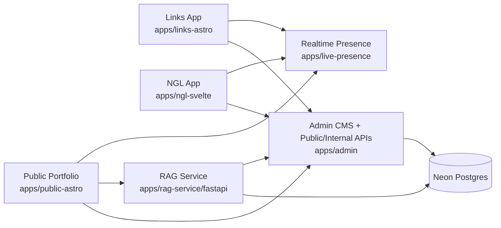

# NaufalRF Portfolio Platform

> Multi-app portfolio platform with Admin as the content authority, Astro/Svelte consumer apps, a FastAPI RAG service, and realtime presence.


## Overview

This repository coordinates the full NaufalRF portfolio ecosystem:

- `apps/admin` — the primary content authority, admin dashboard, public API authority, and internal coordination surface
- `apps/public-astro` — the main public portfolio and AI chat entrypoint
- `apps/links-astro` — the link-in-bio style profile surface
- `apps/ngl-svelte` — the anonymous message experience
- `apps/rag-service/fastapi` — retrieval, embeddings, grounding, and AI workflows
- `apps/live-presence` — realtime presence and cursor state

The root repository is intentionally lightweight. It is **not** a workspace runtime. Each app owns its own dependencies, scripts, and runtime boundaries.

## Architecture



## Application Matrix

| Surface          | Path                       | Stack                 | Default Port | Responsibility                                          |
| ---------------- | -------------------------- | --------------------- | ------------ | ------------------------------------------------------- |
| Public portfolio | `apps/public-astro`        | Astro 5 + React       | `3000`       | Main portfolio, SEO surface, AI chat entrypoint         |
| Admin            | `apps/admin`               | Next.js 16            | `3001`       | CMS, content authority, dashboard, public/internal APIs |
| Links            | `apps/links-astro`         | Astro 5 + React       | `3002`       | Compact links/profile surface                           |
| NGL              | `apps/ngl-svelte`          | SvelteKit 2           | `3003`       | Anonymous messaging                                     |
| RAG service      | `apps/rag-service/fastapi` | FastAPI + pgvector    | `3005`       | Retrieval, grounding, AI workflows                      |
| Live presence    | `apps/live-presence`       | Bun WebSocket service | `3006`       | Realtime presence and cursor state                      |

## Non-Negotiable Platform Rules

- `apps/admin` is the **primary content and API authority**.
- `apps/public-astro`, `apps/links-astro`, and `apps/ngl-svelte` are **API-only consumers** and must not bypass Admin for database access.
- `apps/rag-service` is the approved direct database actor for RAG responsibilities and may call Admin internal APIs for coordination.
- `apps/live-presence` is ephemeral and memory-only.
- Root is a coordination layer only; do not treat it as a shared package or workspace app.

## Current Platform Highlights

### Unified admin communications hub

Admin now consolidates submissions, bookings, availability, NGL messages, guestbook, and related settings under **Contact**. Older standalone list routes still exist as redirects, but the operational center is `/contacts?tab=...`.

### Google Calendar + Meet reconnect flow lives in Admin

Booking automation no longer has to be env-only. Admin now supports a dedicated Google Calendar reconnect flow from **Contact → Settings**:

- reuse the existing Google OAuth client ID and secret already used by Admin sign-in
- complete a separate Calendar OAuth grant
- store the encrypted refresh token and selected calendar in `booking_settings`
- generate Calendar events + Google Meet links when bookings are approved

Important: the migration for the new `booking_settings` Google columns must be applied against a running Postgres instance before that flow works at runtime.

### RAG fallback and intent handling were upgraded

The FastAPI RAG service now:

- handles personal/profile/contact/skills questions more accurately
- uses a generic no-data / low-confidence fallback instead of portfolio-specific dead ends
- supports deterministic freelance-profile lookup for service/rate/profile questions
- preserves hybrid tool answers when retrieval is empty instead of over-abstaining

### Canonical machine-readable site guidance

The repo now uses the public portfolio file as the **canonical format source**:

- `apps/public-astro/public/llms.txt`

Public-facing apps should expose their own `llms.txt` files using that same structure, but each file must be rewritten for the app’s real context and hostname.

Current public `llms.txt` surfaces:

- `apps/public-astro/public/llms.txt`
- `apps/links-astro/public/llms.txt`
- `apps/ngl-svelte/static/llms.txt`

`llms-full.txt` remains intentionally removed.

### Shared presence UX across apps

Public, Links, and NGL now share the same cross-app presence direction using the live-presence service, including the `... Online` wording and reveal-driven presence behavior.

## Quick Start

### 1. Install dependencies

```bash
bun install
cd apps/admin && bun install
cd apps/public-astro && bun install
cd apps/links-astro && bun install
cd apps/ngl-svelte && bun install
cd apps/live-presence && bun install
cd apps/rag-service && bun install
cd apps/rag-service/fastapi && uv sync
```

### 2. Create environment files

```bash
cp apps/admin/.env.example apps/admin/.env.local
cp apps/public-astro/.env.example apps/public-astro/.env
cp apps/links-astro/.env.example apps/links-astro/.env
cp apps/ngl-svelte/.env.example apps/ngl-svelte/.env
cp apps/live-presence/.env.example apps/live-presence/.env
cp apps/rag-service/fastapi/.env.example apps/rag-service/fastapi/.env
```

### 3. Run the local stack

```bash
bun run dev:all
```

This launches the multi-app development stack from the root orchestration script.

## Core Commands

### Root helpers

```bash
bun run dev:all
bun run reset:seed
bun run docker:dev
bun run docker:dev:down
bun run docker:dev:migrate
bun run docker:dev:seed
bun run docker:dev:reset-seed
bun run docker:prod
bun run docker:prod:migrate
bun run docker:prod:bootstrap
bun run lint-staged
```

### App-local development

```bash
cd apps/admin && bun run dev
cd apps/public-astro && bun run dev
cd apps/links-astro && bun run dev
cd apps/ngl-svelte && bun run dev
cd apps/live-presence && bun run dev
cd apps/rag-service && bun run dev
```

### Verification commands

```bash
cd apps/admin && bun run lint && bun run typecheck && bun run build
cd apps/public-astro && bun run build
cd apps/links-astro && bun run build
cd apps/ngl-svelte && bun run lint && bun run check && bun run build
cd apps/rag-service/fastapi && uv run ruff check . && uv run pytest
cd apps/rag-service && bun run build
```

## Google Calendar / Meet Setup

Admin reuses the same Google OAuth app as Admin sign-in, but Calendar authorization is a **separate grant**.

Required env in `apps/admin/.env.local`:

```env
GOOGLE_CLIENT_ID=...
GOOGLE_CLIENT_SECRET=...
NEXTAUTH_SECRET=...
```

Required Google Cloud setup:

- enable the Google Calendar API
- keep the Admin sign-in callback already used by Auth.js
- add this additional redirect URI for Calendar connect:
  - `/api/v1/admin/booking-settings/google/callback`
  - in production this must be the full Admin origin, for example `https://admin.example.com/api/v1/admin/booking-settings/google/callback`

Runtime notes:

- the OAuth refresh token is encrypted before being stored in `booking_settings`
- the selected writable calendar is also stored in `booking_settings`
- booking approval reads that stored connection state to generate Google Calendar events + Meet links
- if the DB migration has not been applied yet, the UI may build successfully but the runtime connect flow cannot persist tokens

## Production Characteristics

### Centralized data authority

All public JavaScript apps consume Admin APIs instead of opening direct database connections. This keeps validation, moderation, auth-aware behavior, and public data contracts centralized.

### AI and retrieval separation

The RAG service owns embeddings, retrieval, and AI workflows. It can access the database directly for approved RAG responsibilities and can call Admin internal APIs for sync and chat-log coordination.

### Realtime presence isolation

Realtime cursor and presence behavior lives in a dedicated Bun service so ephemeral state does not leak into Admin or database concerns.

### Legacy-aware UI baseline

The visual baseline still follows the legacy phase2 direction where required, even as newer work adds richer dashboard interactions, AI workflows, live presence, and SEO improvements.

## Repository Layout

```text
apps/
  admin/            Next.js CMS, auth, APIs, analytics, booking authority
  public-astro/     Main public portfolio and AI chat entrypoint
  links-astro/      Compact links/profile surface
  ngl-svelte/       Anonymous message app
  live-presence/    Bun realtime presence service
  rag-service/      Bun wrapper + FastAPI RAG runtime
.context/           Shared repo context and architecture notes
start-dev.sh        Multi-app local development launcher
reset-seed-rag.sh   Reset, seed, and ingest workflow
scripts/            Docker/dev/prod orchestration helpers
```

## Operational Notes

- Root hook/tooling uses Bun.
- JavaScript apps use Bun; the FastAPI app uses `uv` for Python dependencies.
- `data/` is operational seed/ingest content and should stay local unless you intentionally version fixtures.
- Secrets in `.env*` files must stay placeholders only.
- For meaningful repo behavior, always check `PROGRESS.md` and the nearest `AGENTS.md` before changing architecture or workflows.

## Developer Documentation

For repo rules, learned constraints, and architecture details, read in this order:

1. `AGENTS.md`
2. `PROGRESS.md`
3. nearest app-level `AGENTS.md`
4. relevant `.context/` documents
